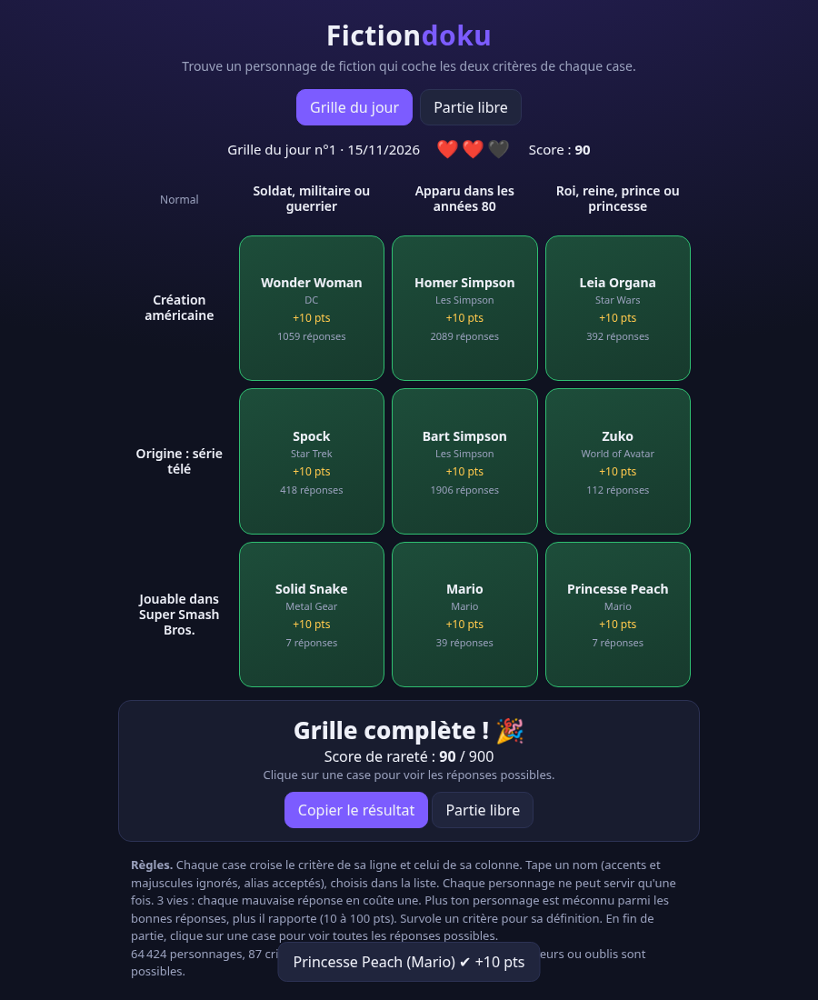

# Fictiondoku

La grille 3x3 des personnages de fiction, façon Pokedoku / Métrodoku. Chaque case croise un critère de ligne et un critère de colonne : trouve un personnage qui coche les deux. Films, séries, BD et comics, manga et anime, jeux vidéo, romans, dessins animés : **61 592 personnages** issus de Wikidata.

▶ **Jouer dans le navigateur (ordinateur et mobile) :** https://doriang-epitech.github.io/Fictiondoku/

Tout tient dans une seule page (`docs/index.html`, données incluses, environ 3,3 Mo) : pas de serveur, ça marche aussi hors ligne.

## Règles

- Une **grille du jour**, la même pour tout le monde (générée à partir de la date), et une **partie libre** en trois niveaux : Facile, Normal, Difficile.
- 9 cases, **3 vies** : une mauvaise réponse coûte une vie.
- Chaque personnage ne peut servir qu'**une fois** par grille.
- **Score de rareté** : dans une case, plus ton personnage est obscur, plus il rapporte (de 10 à 100 points). La réponse la plus évidente rapporte 10, la plus rare 100.
- En fin de partie, clique sur une case pour voir toutes les réponses possibles, des plus connues aux plus rares.
- La progression de la grille du jour est sauvegardée dans le navigateur, et tu peux copier ton résultat pour le partager.

## Les critères (87)

| Famille | Exemples |
|---|---|
| Univers / franchise | Marvel, DC, Star Wars, Star Trek, Harry Potter, Tolkien, Disney / Pixar, Les Simpson, Nintendo, Mario, Pokémon, Dragon Ball, Naruto, One Piece, Game of Thrones, Doctor Who, Looney Tunes, Final Fantasy, Sega, jeux de combat, Shakespeare |
| Équipes et créateurs | Avengers, X-Men, Ligue de justice, Super Smash Bros., créé par Stan Lee, créé par Jack Kirby |
| Support d'origine | manga / anime, jeu vidéo, BD / comics, roman, film, animation, série télé, théâtre |
| Genre de l'œuvre | science-fiction, fantasy, horreur, comédie, policier |
| Pays d'origine | États-Unis, Japon, Royaume-Uni, France / Belgique |
| Époque de la 1re apparition | avant 1950, 1950-79, années 80, 90, 2000, 2010 et après |
| Nature | animal, robot / IA, extraterrestre, créature surnaturelle, super-pouvoirs |
| Rôle | héros masqué, magicien, criminel / méchant, détective, soldat, combattant, scientifique, élève, royauté, pirate, pilote, voyageur temporel |
| Nom et genre du perso | homme / femme, nom en un seul mot, titre dans le nom, initiales identiques, première lettre |

Le nombre de personnages par critère est dans `data/fictiondoku_clean.json` (champ `cats`).

## Notoriété et grilles jouables

La notoriété d'un personnage, c'est son **nombre d'articles Wikipédia** (toutes langues confondues, les « sitelinks » de Wikidata).

- Les grilles sont construites **uniquement avec les 3 945 personnages très connus** (8 langues ou plus). Une case doit avoir au moins 12 (Facile), 5 (Normal) ou 3 (Difficile) réponses très connues, et la grille entière doit avoir une solution avec 9 personnages différents.
- Les quelque 57 600 autres sont **acceptés comme réponses**, et ce sont eux qui rapportent le plus de points.
- Nombre de grilles différentes possibles : environ 6 millions en Facile, 147 millions en Normal, 231 millions en Difficile (`data/grid_counts.json`).
- **Homonymes** : quand un personnage moins connu porte le même nom qu'un autre, d'un univers sans rapport, il n'est accepté que sur ses propres critères.

## Données et méthode

Source : **[Wikidata](https://www.wikidata.org/)** (CC0), via le point d'accès SPARQL `query.wikidata.org`. Les noms sont en français quand ils existent, sinon en anglais. Les alias servent à la recherche (« Peter Parker » trouve Spider-Man).

Pipeline (`tools/`, à lancer depuis ce dossier) :

1. `t1.py`, `t2.py` : toutes les sous-classes de « personnage de fiction » (6 415 classes) → `allclasses.json`.
2. `t3b.py` : tous les éléments de ces classes, sans seuil de notoriété (112 102) → `items_all.json`.
3. `t4b.py` : propriétés (genre, classe, univers, œuvres, créateur, métier, affiliation…), libellés et alias → `raw_chars_all.json`.
4. `t5b.py` : propriétés des œuvres liées (type, pays, date, genre, éditeur, série…) et leurs libellés → `raw_works_all.json`.
5. `t6.py` : arbre des classes (sous-classe de) → `classes_tree.json`.
6. `build.py` : choix des personnages et nettoyage (rôles génériques, rôles d'opéra sans article, éléments sans œuvre…), puis calcul du support d'origine, du pays, de l'époque et du genre.
7. `assign.py` : attribution des critères, définis dans `cats.py` (règles par propriétés Wikidata, ascendance des classes et expressions régulières).
8. `export.py` : fusion des doublons et des homonymes, alias, correction des époques → `data/fictiondoku_clean.json`.
9. `grids.py` : nombre de grilles possibles → `data/grid_counts.json`.
10. `build_site.py` : `docs/data.json` et `docs/index.html` (à partir de `template.html` et `core.js`).

Tests : `node test.js` (logique du jeu, génération de grilles) et `node e2e.js` (navigateur sans interface, nécessite `npm i puppeteer-core` et Google Chrome).

Les caches Wikidata intermédiaires (environ 100 Mo) ne sont pas versionnés : les étapes 2 à 4 les régénèrent en quelques minutes.

### Fichiers

- `docs/index.html` : le jeu complet (HTML, JS, données) servi par GitHub Pages.
- `docs/data.json` + `docs/core.js` : les mêmes données et la même logique, séparées.
- `data/fictiondoku_clean.json` : le jeu de données propre. Pour chaque personnage : nom, alias, notoriété, critères, QID Wikidata, année de 1re apparition et critères de ses homonymes.

## Limites connues

- Un héros et son identité secrète sont parfois deux entrées distinctes (Batman et Bruce Wayne, Daredevil et Matt Murdock).
- Beaucoup de personnages peu connus n'ont qu'un nom anglais.
- Il reste quelques erreurs ou approximations de Wikidata (Merlin et le TARDIS rangés dans Star Trek, par exemple). Les personnages rares ont plus souvent un support ou une époque manquants.

## Aperçu

